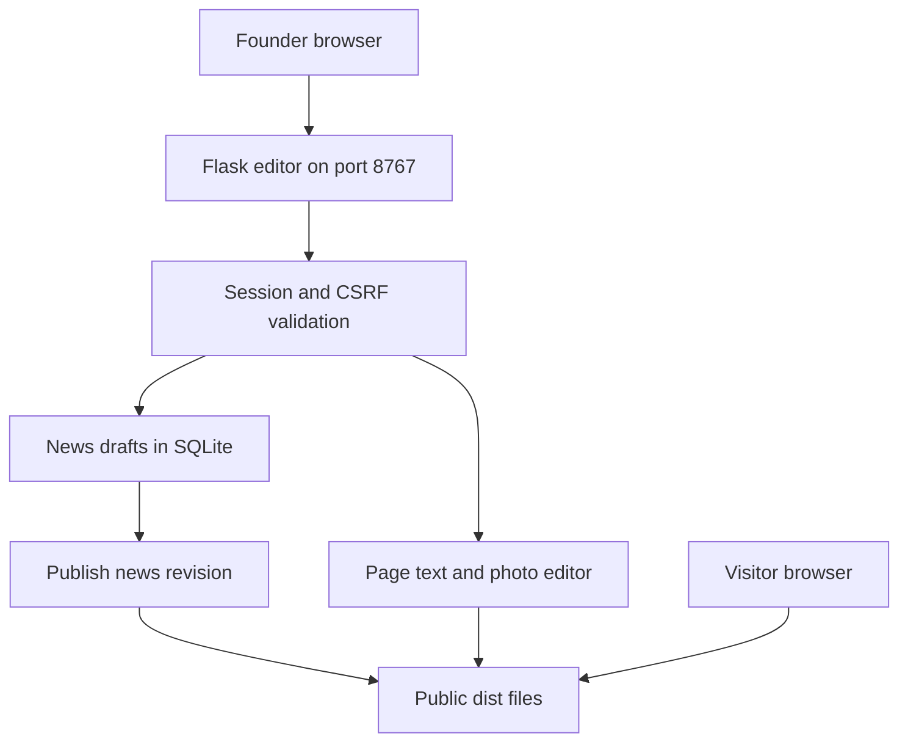
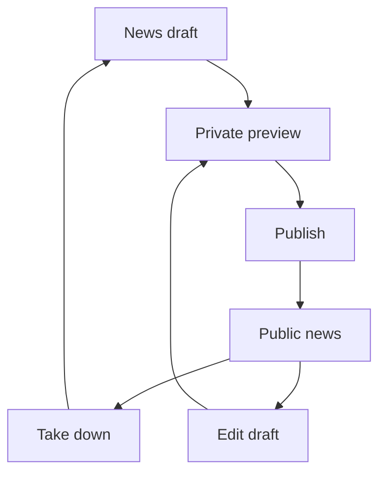
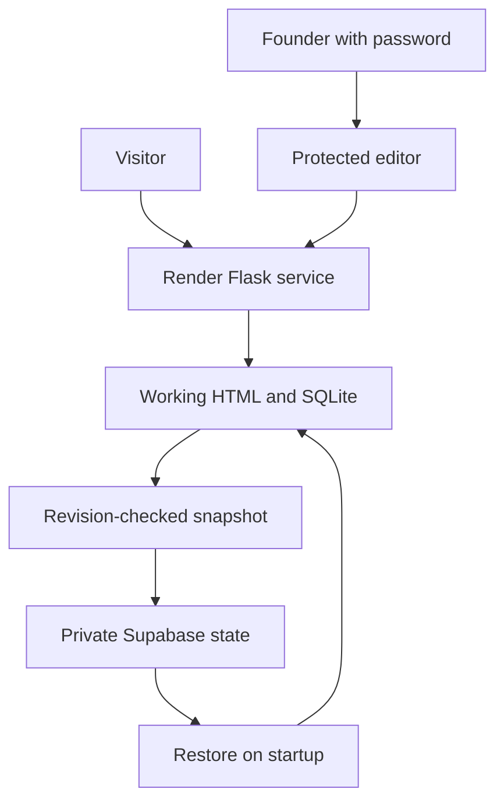
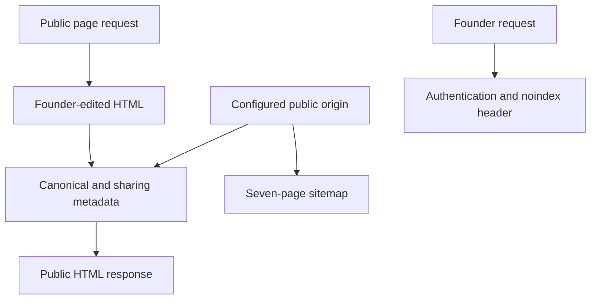

# BeHeard Zimbabwe

## Current deployment — 27 November 2026

- Public website — https://beheard-public.onrender.com/
- Founder dashboard — https://beheard-zimbabwe.onrender.com/founder/
- Public pages on the former address redirect to the static site.
- Public static hosting stays available independently of Flask inactivity. The free admin service can sleep.
- Supabase holds revision-checked durable snapshots of pages, the private database, drafts and credentials.
- Automatic static publication through the Render deploy hook is verified.
- The public build contains nine pages, approved media, CSS, JavaScript, canonical/Open Graph metadata, robots.txt and sitemap.xml.
- Private routes, drafts, database files and server credentials are excluded from public artifacts.

See [STATIC_PUBLICATION.md](STATIC_PUBLICATION.md) for publication security and failure handling.

## Content completed

The official logo, founder biography and portrait, uniforms and stationery, sewing story, family housing media, family donation story, Christmas posters and scholarship birthday photographs are published. Family stories have Housing and Donation categories. Programme sections link to matching stories. The gallery contains the birthday photographs and excludes the founder portrait.

## Editing and deployment

The authenticated Flask founder dashboard supports draft/preview/publish/take-down for news and immediate saves for website page edits. Hosted HTML and SQLite restore from Supabase at startup. Durable saves must succeed before an export is confirmed and a static deployment is requested.

Hosted snapshots contain current page content. Repository HTML edits can be superseded by restoration. Approved deployment changes use one-time migrations with settings markers. Shared CSS, JavaScript, templates and allowlisted media are repository-managed.

Use python publisher.py serve for a complete local preview on port 8767. A plain static preview of dist omits runtime gallery rendering and SEO. Use python publisher.py setup only to establish or reset a local founder password.

Production configuration is recorded in render.yaml. Staging configuration is in render.staging.yaml. Manage secrets through Render Environment and preserve existing Supabase/authentication settings. Never commit credentials, snapshots, private SQLite files or tokens.

## Verification completed

The publication suite passed 20 tests during rollout. Live checks covered nine public pages and 25 original assets, metadata and sitemap, private-route rejection, old-address redirects, login availability and automatic deploy-hook delivery. Subsequent content/layout changes were checked on the live site.

Run python -m unittest discover -s tests -q for publication regression checks. Verify applicable browser behavior and Render deployment status after changes.

## Remaining work

| Area | Remaining action |
| --- | --- |
| Custom domain | Confirm ownership/DNS access for www.beheardzim.org, connect it and verify HTTPS before updating canonical URLs. |
| Board and team | Supply approved biographies and photographs for additional members. |
| Counselling story | Supply approved content before adding its programme success-story link. |
| Donations | Confirm a provider and payment methods if online once-off/recurring payments are required. Current links provide information and contact options. |
| Enquiries/newsletter | Agree services for direct form submissions, appointment requests and subscriptions. Current enquiry actions use contact/email links. |
| Launch administration | Founder sign-in/training, privacy and safeguarding review, and confirmation that contact channels reach responsible staff. |
| Search Console | Verify ownership and submit the sitemap when domain and organisation Google-account access are available. |

The deployment uses the existing free hosting arrangement. Domain purchases and paid services require an explicit decision.

## Earlier implementation notes

The dated notes below record earlier implementation stages. The current deployment and remaining-work sections above supersede their old status claims.

## Preview on Windows

With Python 3 installed, run these commands in PowerShell.

```powershell
cd "C:\Users\hp\Documents\BeHeardProject"
python -m http.server 8765 --bind 127.0.0.1 --directory dist
```

Open [the local preview](http://127.0.0.1:8765/) in your browser. Press `Ctrl+C` in PowerShell to stop the server. Serve `dist` as the site root because navigation and asset URLs start with `/`.

## What visitors can use today

| Page | What it contains |
| --- | --- |
| [Home](dist/index.html) | Introduction to BeHeard, featured programmes, stories and ways to contribute. |
| [About us](dist/about.html) | Mission, vision, values and founder Ashley Mutamiri’s profile. Space is reserved for board and team biographies. |
| [Programmes](dist/programmes.html) | Carlos’ Crusaders Scholarships, counselling and psychosocial support, women and community empowerment, child protection and welfare, and community outreach. |
| [Stories and updates](dist/stories.html) | Three examples from the brief covering a sewing machine, school uniforms and scholarships. The news and events section awaits its first update. |
| [Get involved](dist/involved.html) | Donation and sponsorship options. Visitors can ask for payment instructions, express interest in volunteering or partnering, and request updates by email. |
| [Contact](dist/contact.html) | Phone, email, WhatsApp, street address and map links. Counselling enquiries are directed to the team by phone. |
| [Privacy and safeguarding](dist/privacy.html) | Draft notice covering enquiries, external services and consent for use of stories and photographs. |

The site uses the brief’s navy, lime, mustard and white palette, a responsive layout and a mobile menu. General enquiries, volunteer and partnership requests, and requests for updates open a draft in the visitor’s email app. The visitor sends the message from that app. The site itself stores no submissions.

## How to update the current site

The files in `dist/` are the editable website. It uses HTML, CSS and plain JavaScript and runs without a build step or database.

| To change | Edit |
| --- | --- |
| Page text, stories, programme details or page-specific contact buttons | The relevant HTML file listed above |
| Shared navigation, footer contact details or mobile menu behaviour | [dist/site.js](dist/site.js) |
| Colours, typography, illustrations, spacing or mobile layouts | [dist/styles.css](dist/styles.css) |

### Founder news publishing

Ashley Mutamiri is the sole dashboard account. From the project folder on Windows, install the dependencies if needed and let Ashley enter her password at the private terminal prompt.

```powershell
python -m pip install -r requirements.txt
python publisher.py setup
python publisher.py serve
```

Open <http://127.0.0.1:8767/founder/> on this computer. If the editor is already running, just run the setup command. Re-running setup changes the password and invalidates existing signed-in sessions. Local operating-system access to the project and its private files is administrative access.

Choose **Create an update**, enter the title, date and text, and optionally add an approved photograph and description. **Save draft and preview** keeps the changes private. **Publish update** places that revision in News and Events. Later edits stay private until published. **Take down** removes the public version and retains the draft.

The publisher updates the marked section in `dist/stories.html`. Keep both news markers when editing that file. The static preview on port 8765 and the public view on port 8767 read the same file. For hosting, deploy only `dist/` after publishing. The local dashboard and its database stay separate from the public files. Private drafts, photos, published revisions and credentials live in `.beheard/publisher.sqlite3`. Back up that directory privately while the editor is stopped. Remote founder access will require hosting the editor with HTTPS and persistent private storage or providing it on the founder's computer.

## Remaining work

| Area | Next milestone |
| --- | --- |
| Domain and hosting | Confirm or register the preferred domain under BeHeard Zimbabwe’s control, connect it to static hosting, verify HTTPS and set up regular backups. |
| Staff publishing | Activate the founder password, arrange production publishing and train the founder. The current editor covers news updates and their photographs. |
| Content and branding | Add the official logo, approved founder and project photos, board and team biographies, confirmed social links and news. Build the photo and video gallery with consent-cleared material. |
| Donations | Confirm payment methods and connect a provider for once-off and recurring donations. The current Donate button leads to information and an enquiry link. |
| Enquiries and subscriptions | Connect general enquiry and volunteer forms, a confidential counselling appointment request process and newsletter subscriptions. |
| Launch review | Approve the privacy and safeguarding notice against the final services and confirm that enquiries reach the right staff. |

## Checks completed

On 25 November 2026, all seven HTML pages, the stylesheet and the shared script returned HTTP 200 from a local static server. Internal page links and section anchors resolved, and `node --check dist/site.js` passed. These checks covered the local files. Live hosting and delivery through external contact services remain unverified.


## Website editing and appearance

The founder dashboard now includes **Edit website pages and photographs**. Select a page, edit its plain text fields and save. These page edits publish immediately to the local website. A version check rejects edits when someone else has changed the page since it was opened. News continues to use its separate draft, preview and publish workflow.

Each page supports one optional photograph displayed as a wide moving photo band at the bottom. Uploading a replacement replaces the current page photograph. A description is required. The remove checkbox removes it. Reduced-motion preferences stop the animation. This is the first photo placement available in the editor. Placement within individual sections and multiple hero slides still require implementation.

The public site has a persistent Light mode / Dark mode button. The palette uses navy, lime, mustard and white across contrasting sections. Public text still follows the approved brief. New text entered by the founder becomes organisation-approved content.

## Architecture

The public website is static HTML, CSS and JavaScript. Flask supplies the private local editing interface. SQLite stores news drafts, published news revisions and founder credentials. Page edits write directly to the HTML files. Page photographs are validated, resized and embedded as JPEG data. Passwords use salted hashes.





| File or folder | Responsibility |
| --- | --- |
| publisher.py | Founder login, sessions, news workflow, page editing and publishing |
| templates/founder.html | News dashboard and sign-in |
| templates/pages.html | Page text and photograph editing |
| templates/articles.html | Escaped public news markup |
| dist/ | Public website files for static hosting |
| .beheard/ | Private SQLite database and credentials |
| requirements.txt | Python dependencies |

Only publish the dist folder. The editor currently runs on the local computer. Production remote editing still needs HTTPS, persistent private storage and a deployment connection. Back up both dist and .beheard before changes. Restart the Python editor after changing its source.


### Contrast correction

Buttons use explicit foreground and background pairs instead of the document text colour as their background. Hero and dark-mode buttons use navy text on lime, including hover states. The same correction covers founder buttons, donation links and focus outlines.

### Friendly page editor and homepage sequence

The editor uses Home, About, Programmes, Stories, Donations and volunteering, Contact and Privacy as page labels. It exposes paragraph descriptions grouped by their nearest heading. Category names, headings, values and navigation are protected. Published news remains managed through the news workflow. A saved-page preview appears beside the editing form.

Home supports up to six uploaded photographs with a description for each, displayed above the introduction. The sequence advances every 5.5 seconds and has a play/pause button. It pauses while hovered, focused or in a hidden tab. Reduced-motion preferences start it paused. These images are supplied by the founder. Existing page photographs remain available as a separate feature.


### News layout and two-colour palette

Navy and white are the main site colours. Light mode uses white and pale blue surfaces with navy text. Dark mode uses navy surfaces with light text. Lime remains on key buttons and small accents. Full-width mustard and green section fills have been removed.

News photographs fit a consistent 16:10 crop with softened corners. On wider screens, each photograph sits beside its article text; on phones it stacks within the article. Existing published articles receive the layout through shared CSS. News sections use the available page width.


### Photo upload allowance

The founder editor accepts requests up to 100 MiB, allowing six homepage photographs and an optional page photograph in one save. Use a total below 100 MB to leave room for form data. Images are still validated, resized and converted to JPEG. Requests above the limit receive a styled explanation and a return link. Production hosting must allow the same request size.


### Homepage photo descriptions

Selecting homepage photos now displays a thumbnail and optional description for each file. Blank descriptions save as empty alternative text. Add descriptions for meaningful photographs to make them accessible to screen-reader users. The older multiline description input remains accepted for submissions from already-open editor tabs.


### Selected Canva design

Visual reference: https://canva.link/xmgyi6h8urrufcp (DAHb85YZSYA, Brand Color Dark/Light Theme). The website adapts its bold sans-serif typography, generous spacing, rounded panels and pill-shaped buttons. The homepage sequence uses uploaded photographs within a rounded frame. The large decorative lime image panel in the reference is replaced by actual uploaded photography and content. The founder editing workflow, public copy, theme switch, navigation and photo controls remain available.


### Choosing and removing photographs

The page editor displays the current page photograph and all saved homepage slides. Select individual homepage photographs for removal and save changes. Selecting every saved slide removes the sequence. Uploading a new sequence replaces the old sequence; removing the whole sequence takes precedence. The page photograph can be replaced using the file chooser or removed using its checkbox. News photographs are managed within the corresponding news draft.

### Verification on 26 November 2026

Isolated tests passed for founder sign-in, description editing, protected headings, page photo upload/replacement/removal, homepage sequence upload, individual slide removal, full sequence removal, invalid upload rejection, visitor edit blocking, private-file protection, news draft privacy, HTML escaping, publication, correction, stale revision rejection, withdrawal and logout. Tests used temporary copies and generated image data that was discarded after testing.

Browser checks covered the homepage at phone and desktop widths, light and dark modes, and opening mobile navigation. The phone homepage had no horizontal overflow. The editor image policy now permits blob URLs used by selected-photo thumbnails. Hosting remains pending a provider and cost decision.


## Render deployment

The repository includes render.yaml and wsgi.py for one paid Python web service with a 1 GB persistent disk. Confirm the price shown by Render before provisioning.

1. Upload the source to a private GitHub repository, excluding .beheard, .env files and local credentials.
2. In Render, create a Blueprint from that repository and review render.yaml.
3. Deploy after approving the service and disk cost.
4. In the Render service Shell, run python publisher.py setup. The founder enters a new password privately.
5. Open the service URL and /founder/. Check /healthz, public pages, sign-in and publication.

BEHEARD_DATA_DIR places private credentials and SQLite in /var/data/beheard/private and public editable HTML in /var/data/beheard/public. Only the public subdirectory is served. Code redeploys refresh scripts and styles; previously edited HTML is retained. Deliberate HTML layout changes require a migration or a backed-up manual merge into the persistent pages.

RENDER_EXTERNAL_HOSTNAME allows the generated host and enables Secure session cookies. Add custom domains using BEHEARD_DOMAINS, separated by commas. Render handles HTTPS. Production uses one Gunicorn worker and one request thread to serialize filesystem edits. The private database is created afresh on Render; the local founder password is never uploaded.

Back up the private database using SQLite's backup API and copy the persistent public folder together. Store backups outside this disk and test restoring them. Credentials remain outside Git.


### Free Render preview

The current render.yaml uses the free web service plan and /tmp/beheard, without a paid disk. SQLite, founder credentials and uploaded or edited content on this preview are temporary and can disappear when the instance restarts or redeploys. The public site starts from the source-controlled pages. The local founder password is excluded, so cloud sign-in remains unconfigured. Use the local dashboard for durable editing until persistent hosting or an external datastore is configured. Free instances can sleep after idle periods. This preview incurs no paid service or disk provisioned by this configuration.

### Deployment verified on 26 November 2026

Live preview: https://beheard-zimbabwe.onrender.com/
Render service: srv-dc3p0qbl550s73f56h80
The initial free deployment reached live status and the homepage was verified in the browser over HTTPS. The service uses the free plan in Oregon with no persistent disk. Cloud founder credentials are unconfigured. Continue using the local founder dashboard for saved edits until durable cloud storage is connected.


## Durable storage on free Render

The hosted editor now uses a dedicated Supabase project for durable snapshots of the SQLite database and edited HTML, including embedded photographs. The existing founder password hash is supplied privately through Render environment settings, then retained in the private snapshot. Credentials and drafts are never sent to public pages.

cloud_state.py restores state at startup and saves successful founder changes before confirming the request. A revision check prevents overlapping deployments from overwriting a newer snapshot. Run one Gunicorn worker/thread and one Render instance. Storage failures return an error instead of claiming the save succeeded.

The Supabase state table has row-level security. Its API requires both the publishable key and a server-only random token stored in Render. Neither is included in browser scripts. Free Render can still sleep when idle. Supabase free limits and availability still apply.

### Hosted configuration verified on 26 November 2026

The live Render service now uses free Supabase project zervutwgwjxgranjcqyd for durable editor state. This supersedes the earlier temporary-storage limitation. The existing local founder account was provisioned privately on the host. Sign in at https://beheard-zimbabwe.onrender.com/founder/ using the existing founder password.

The deployment reached live status. The health endpoint returned ok. Supabase contains snapshots of all seven pages, and a subsequent deployment restored that state. Anonymous access without the server token returned no rows; the Supabase security advisor reported no findings. Snapshot save/restart recovery was tested on isolated copies. The browser sign-in form is active; a successful interactive password submission remains for the founder to verify.



Free service limits still apply. A free Render instance can sleep. Domain registration, payment-provider details, approved photographs and full enquiry/newsletter form services remain separate unfinished scope items. The current deployment covers the existing public pages and founder content-editing workflow.


## Search optimisation - 26 November 2026

`seo.py` adds delivery-time canonical links and Open Graph sharing metadata to all seven public pages. Titles and descriptions reuse the approved HTML wording. This also covers HTML restored from Supabase; saved founder content is not overwritten. `/index.html` redirects permanently to `/` to consolidate the homepage URL.

`/sitemap.xml` lists the seven public canonical URLs and `/robots.txt` advertises it. Founder routes, redirects and errors return `X-Robots-Tag: noindex, nofollow`; authentication remains the actual privacy boundary. Crawlers may fetch the login page to read that instruction. Drafts remain protected by sign-in and are absent from the sitemap.

The canonical origin currently defaults to `https://beheard-zimbabwe.onrender.com`. After domain purchase, DNS and HTTPS verification, set `BEHEARD_PUBLIC_URL` to the chosen HTTPS origin (without a trailing path) and add both root and www hosts to `BEHEARD_DOMAINS`. Redeploy and verify canonical URLs and the sitemap. Do not switch the origin to an unverified domain.

Isolated Flask checks passed for all seven pages, unchanged body wording, canonical and sharing tags, GET/HEAD, XML sitemap parsing, robots sitemap discovery, founder noindex, homepage redirect, 404s and tracking queries. These checks do not measure search rankings or Core Web Vitals.

Google Search Console ownership verification and sitemap submission remain pending domain registration and access to the organisation's Google account. No new public wording or placeholder images were added. Existing descriptive photo fields remain available to the founder; images still need approved uploads.




## Official logo - 26 November 2026

The organisation-supplied JPEG is stored unchanged at `dist/beheard-logo.jpg`. Shared navigation and footer markup in `dist/site.js` use this asset on all public pages, with descriptive alternative text and explicit dimensions. CSS preserves its aspect ratio and white background in both themes; header spacing accommodates the square artwork on desktop and mobile. No AI-generated replacement or recolouring is used. The normal deployment asset refresh copies the logo alongside CSS and JavaScript, preserving founder-edited HTML and photographs.


## School uniform story slideshow - 26 November 2026

Three consent-approved photographs accompany the existing Educational Support paragraph on Stories. Optimised JPEGs (`dist/uniform-1.jpg` through `uniform-3.jpg`) preserve the supplied face pixelation and portrait framing. The responsive gallery uses contain sizing, navy/white theme surfaces, previous/next controls, keyboard arrows, swipe scrolling and pause/play. Automatic movement pauses on hover, keyboard focus and hidden tabs; reduced-motion preferences start it paused.

`uniform_gallery.py` installs the gallery once after restoring hosted state, using a private settings marker. Later founder removals are not recreated by restarts. This migration preserves surrounding page edits and published news. In Founder > Website pages > Stories, the founder can remove individual photos, replace the sequence or remove it completely. Images uploaded there stay in the existing durable HTML snapshot workflow. Existing public story wording is retained.

Local checks verified one-time installation, public page delivery and removal surviving a restart. JavaScript syntax and browser layout/controls are checked before deployment.

### Header and uniform story refinement

The header is compact on desktop and phones. Desktop dropdowns open on hover, with contrasting colours in both themes, and still support keyboard and touch activation. The smaller uniform gallery advances every three seconds with manual arrows and no pause button. Reduced motion uses instant transitions. The approved story caption is applied once to stored pages.

Educational Support now groups its Success Stories into Uniforms and Stationary. The Uniforms category contains the approved description and existing slideshow. Stationary contains the two supplied school-supply photographs. The desktop tabs place the gallery beside the text and the mobile layout stacks them. The group photo is used as the homepage hero background.

### Site navigation and page coverage

Our Board and Team and Gallery are standalone pages. About Us links to the founder and team. Success Stories links to Gallery and News and Events. Our Programmes links to the scholarship and counselling content. Donate and Volunteer and Partner With Us remain linked sections of Donations and Sponsorships, and Privacy Policy is in the footer. The Stationary caption is installed once in the stored Stories page and can be edited in the founder dashboard.

Success Stories includes the sewing machine story and Assisting Vulnerable Families. The programme page links to the sewing story. Videos use standard controls with playback on demand.

The homepage hero rotates the school visit, family donation and community photos every three seconds. Success Stories includes a separately identified family donation, photos and videos of the former home, and the Children’s Christmas Party announcement in News and Events.

The homepage uses the community group photo and displays the same published News and Events section as Stories. Light mode is the default, with Dark mode and System settings available in the colour selector. The Gallery groups the supplied photos by story and event.

The home-only floating News and Events link jumps to the news section. An open navigation dropdown dims the page behind the header.

## Donation setup in preparation

The donation methods template supports bank transfer, EcoCash and official PayPal links. Public receiving details belong in donation_settings.json. Empty or incomplete methods show a pending message and have no payment action. Never put passwords, PINs or API keys in this file. Bank monthly support uses donor-arranged standing orders. EcoCash monthly support uses repeat donor payments. Enable the PayPal monthly link only after the organisation account supports recurring donations and its hosted checkout is verified. Configuration changes require an admin deployment and a verified static publication. This setup is staged pending receiving details.

Social links for Instagram, TikTok and Facebook are in the footer alongside email. Seven birthday photographs appear in the scholarship story and gallery. USD bank transfer receiving details supplied by the organisation are configured. The beneficiary is Ashley Sibanda. EcoCash and PayPal details remain pending.

EcoCash receiving number is configured under Ashley Mutamiri. Currency remains unspecified pending confirmation. A prominent bank note explains that the beneficiary name appears as Ashley Sibanda.
